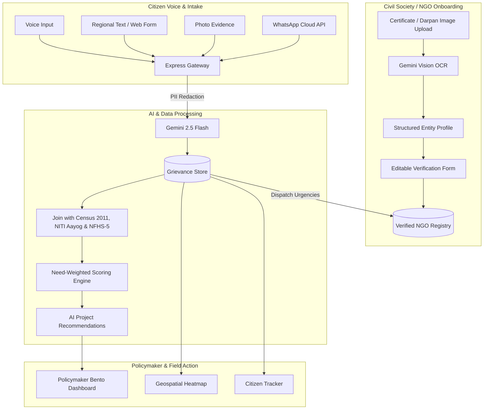

<h1 align="center">Seva-Sankalp (सेवा-संकल्प)</h1>
<p align="center"><b>Civic Intelligence & NGO Onboarding Ecosystem</b></p>
<p align="center"><i>Multilingual citizen voice aggregation, need-weighted infrastructure prioritization, and AI-powered NGO partner onboarding.</i></p>

---

## 🌟 Overview

**Seva-Sankalp** is a next-generation civic governance and digital public infrastructure (DPI) platform for India. It bridges the gap between citizens, civil society organizations (NGOs), and policymakers by transforming unstructured citizen reports (voice, regional text, photos, WhatsApp) into need-weighted infrastructure priorities and connecting verified grassroots NGOs directly to local civic issues.

### Key Capabilities

1. **Multilingual Citizen Reporting**:
   - Voice transcription in 10+ Indian languages (Hindi, Tamil, Telugu, Bengali, Marathi, Gujarati, Kannada, Malayalam, Punjabi, Odia, English).
   - Gemini Multimodal image hazard detection & PII redaction.
   - WhatsApp Cloud API webhook intake with automated bilingual status receipts.

2. **AI-Powered NGO Partner Onboarding & Verification**:
   - **Document Image Acceptance**: NGOs onboard seamlessly by uploading registration documents (NITI Aayog NGO-DARPAN Certificates, Registered Trust Deeds, Societies Registration Act XXI of 1860, or Section 8 Company MCA Certificates).
   - **Gemini Multimodal Vision OCR**: Automatically extracts organization name, unique Darpan ID, entity type, founding year, key signatories, phone, email, website, operational districts, and civic focus sectors.
   - **Editable Representative Profile**: NGO representatives can review, edit, and fine-tune all details before enrollment.
   - **Partner Directory & Grievance Routing**: Verified NGOs are enrolled in the active partner registry and can receive direct routing of urgent citizen grievances in their districts.

3. **Need-Weighted Prioritization Engine**:
   - Joins citizen reports with national datasets: **Census 2011 population & literacy**, **NITI Aayog Aspirational Districts**, and **NFHS-5 household indicators**.
   - Need-weighted scoring ensures that under-served rural districts and high-deprivation areas outrank high-volume urban metros in capital repair allocations.

4. **Geospatial Demand Heatmap**:
   - High-performance Google Maps & deck.gl visualization surfacing infrastructure distress clusters across roads, drinking water, healthcare, sanitation, and electricity.

---

## 🏗️ Architecture



---

## 🛠️ Tech Stack

- **Frontend**: React 19, TypeScript, Vite, Tailwind CSS, Lucide Icons, Recharts, Deck.gl
- **Backend**: Node.js, Express, Multer, Axios, Helmet, CORS
- **AI & Multimodal Vision**: `@google/genai` (Gemini 2.5 Flash) for multimodal document OCR, voice transcription, translation, and category classification
- **Data & Storage**: Firebase / Cloud Firestore & Cloud Storage (with full zero-dependency in-memory sandbox demo mode)
- **Maps**: Google Maps JavaScript API & Deck.gl geospatial overlays
- **Testing**: Node.js test runner (`tsx --test lib/*.test.ts`), Playwright

---

## 🚀 Quick Start

### 1. Prerequisites
- Node.js 20+ installed
- npm or bun

### 2. Clone and Install
```bash
git clone https://github.com/Aamirbadar07/Seva-Sankalp.git
cd Seva-Sankalp
npm install
```

### 3. Environment Setup
Copy the example environment configuration:
```bash
cp .env.example .env
```
*(In demo mode, no external API keys are strictly required; fallback rule-based classification and simulated OCR run automatically.)*

To enable live Gemini AI classification and multimodal vision OCR:
```bash
GEMINI_API_KEY="your-gemini-api-key"
```

### 4. Run Locally
```bash
npm run dev
```
Open **[http://localhost:3000](http://localhost:3000)** in your browser.

---

## 🧪 Testing & Quality Assurance

Run the complete test suite:
```bash
npm run test
```

Run TypeScript compilation check:
```bash
npx tsc --noEmit
```

Build production bundle:
```bash
npm run build
```

---

## 📜 License

Distributed under the Apache 2.0 License.
